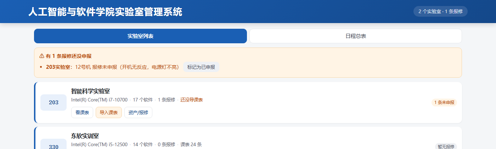
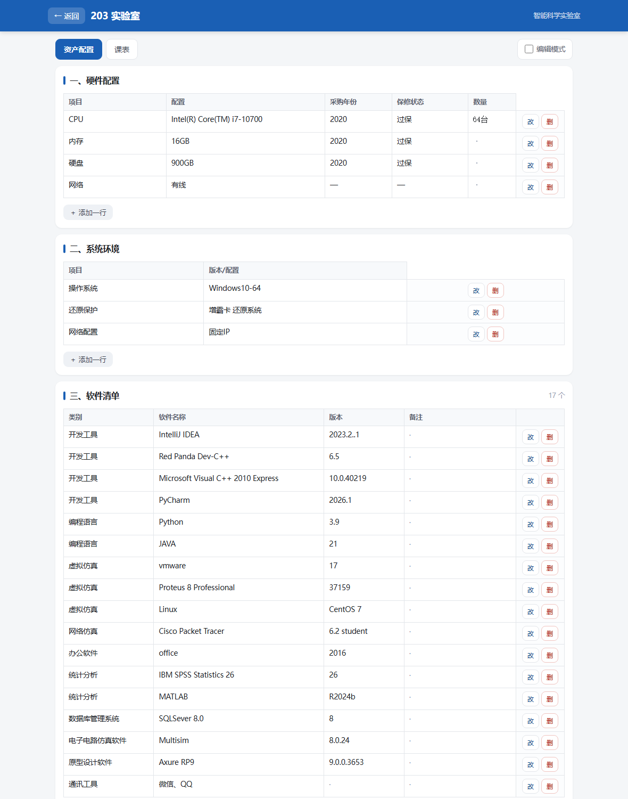

# 实验室管理系统 · Lab Manager

给高校实验室管理员用的单文件网页工具：**查空房、看课表、管设备配置、登记报修**——一个 HTML 文件，双击就能用，不装软件、不连网、不需要服务器。



## 为什么做成这个样子

实验室的实际管理者通常不是程序员，也没有 IT 部门随时待命。所以这个工具刻意做成了最"土"也最省事的形态：

- **一个文件**：整个程序就是一个 `实验室管理.html`，图标都内嵌在文件里
- **零依赖**：没有框架、没有构建步骤、不引用任何 CDN，断网照样跑
- **零安装**：双击用浏览器打开即可，拷到 U 盘就能带到另一台电脑
- **数据不出门**：所有记录存在本机浏览器的 localStorage 里，不上传任何地方

## 功能

| 模块 | 能做什么 |
|---|---|
| 实验室列表 | 卡片式总览，一眼看到每间实验室的状态、容量和设备概况 |
| 日程总表 | 按周次展开全部实验室的占用情况，找空房用 |
| 查空房 | 选定周次和节次，直接筛出没课的实验室 |
| 课表管理 | 导入 `.xls` / `.xlsx` 课表文件，不用另存格式；支持单间导入和批量导入 |
| 设备配置 | 每间实验室的硬件、软件、系统分项登记，可增删改 |
| 报修登记 | 记录报修问题、跟进状态，一键导出 Excel 报表 |
| 备份恢复 | 导出 `.json` 备份，换电脑时导入即可恢复 |

## 快速开始

1. 从 [Releases](../../releases) 下载完整压缩包，或直接下载 `实验室管理.html`
2. 把文件放进一个**固定的文件夹**（建议桌面），之后不要随意移动
3. 双击打开（推荐 Chrome / Edge）
4. 第一次使用：先填「本学期第一周日期」，再导入课表文件

更细的上手步骤见 [使用说明.md](使用说明.md)——那份文档是写给"不熟悉电脑操作的人"的，从怎么双击开始讲。



## 数据在哪，怎么备份

- 数据存在浏览器的 **localStorage** 里，和「文件所在位置 + 浏览器」绑定
- 因此：换文件夹、换浏览器、换电脑，数据都不会跟着走
- 用「导出备份」生成 `.json` 文件，换机器后用「导入备份」读回来
- **建议每周备份一次**，备份文件放网盘或移动硬盘

> 注意：直接把文件挪到别处再打开，看到的会是空白。要移动就先备份，到新位置再导入。

## 技术说明

- 单文件 HTML（约 160 KB）+ 原生 JavaScript，无框架、无构建、无外部依赖
- 课表导入直接解析 Excel 文件，报修报表直接导出 Excel，全在浏览器本地完成
- 通过 `file://` 直接打开，不需要任何后端服务

## 目录结构

```
lab-manager/
├── 实验室管理.html          # 主程序（就是全部）
├── 使用说明.md              # 面向非技术用户的详细手册
├── assets/                  # 图标（png / ico）
├── preview/                 # 界面截图
├── scripts/                 # 创建桌面快捷方式的小脚本
├── docs/需求定稿.md          # 动工前的需求梳理，可以看到取舍过程
├── LICENSE
└── README.md
```

## 已知限制

- **单机单人**：多人同时使用需要改造成服务端版本，当前版本没有账户体系
- **数据绑浏览器**：清理浏览器数据或换浏览器会看不到原有记录，务必定期备份
- 主要在 Chrome / Edge 上验证，其他浏览器未充分测试

## 许可证

[MIT](LICENSE)
